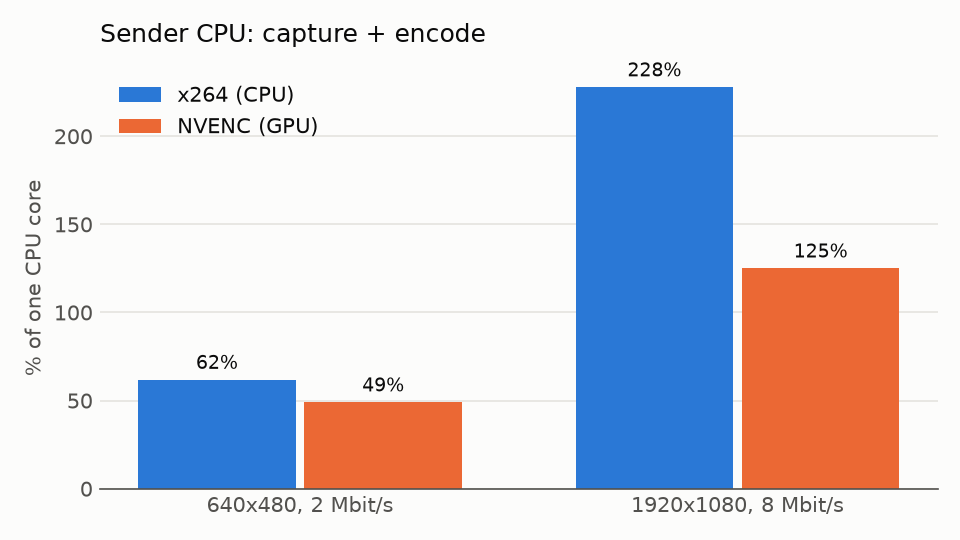
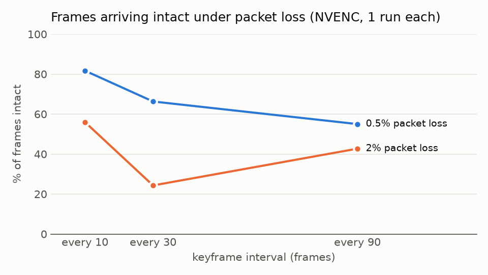

# camvision: GStreamer + OpenCV motion detection with latency metrics

A small demo of a camera pipeline: grab frames with **GStreamer**, detect motion with **OpenCV**,
push annotated frames back into GStreamer for display or recording, and measure what happens
on every frame.

```
v4l2src / videotestsrc / filesrc ─► decode ─► BGR ─► appsink ──► OpenCV MOG2 motion detection
                                                                     │
                     autovideosink / vp8enc ! webmmux ◄── appsrc ◄───┘ (boxes + HUD)
                                                                     │
                                                    metrics.csv + p50/p95 summary
```

## Run

```bash
python3 -m venv --system-site-packages .venv      # system site-packages for GStreamer's `gi`
.venv/bin/pip install -r requirements.txt

.venv/bin/python -m camvision --source test --output display          # synthetic bouncing ball
.venv/bin/python -m camvision --source webcam --output display --frames -1
.venv/bin/python -m camvision --source webcam --exposure 1200 --output display   # bright, 8 fps
.venv/bin/python -m camvision --source webcam --exposure 330 --gain --output display  # 30 fps, noisier
.venv/bin/python -m pytest -q
```

## Streaming over RTP/UDP

```
camera ─► detect ─► stamp capture time ─► x264 (zerolatency) ─► RTP ─► UDP
                         into pixels                                      │
             receiver: UDP ─► jitter buffer ─► H.264 decode ─► read stamp ─► end-to-end latency
```

```bash
.venv/bin/python -m camvision.receive --display                                   # terminal 1
.venv/bin/python -m camvision --source webcam --exposure 330 --gain --output rtp --frames -1   # terminal 2
```

The capture time is written into each frame as 40 black/white 16x16 blocks (bottom-left),
aligned to H.264 macroblocks and protected by a checksum (`camvision/timestamp.py`). Because it
travels inside the picture, the receiver measures the whole path: capture, processing,
encoding, network and decoding. It does not include the display itself.
Sender and receiver must share a clock (same machine, or NTP-synced machines).

First results (same machine, 640x480 at 30 fps, x264 at 2 Mbit/s, first 10 frames skipped):

| source | e2e p50 | e2e p95 | lost |
|---|---|---|---|
| synthetic (`videotestsrc`) | 24 ms | 34 ms | 0 |
| webcam, exposure 330 + gain | 59 ms | 70 ms | 0 |

Webcam breakdown: about 32 ms camera to Python, 10 ms detection, 17 ms encode + network + decode.

**The jitter buffer setting didn't change latency here** (0, 50 and 500 ms all gave about 24 ms).
`rtpjitterbuffer` passes in-order packets straight through and only waits when one is missing,
so on a clean link its `latency` is never used. It matters once packets are lost or reordered.

## Experiments: encoders, bitrate and bad networks

```bash
.venv/bin/python -m camvision.sweep          # 20 runs, ~5 min -> results/sweep.csv
.venv/bin/python -m camvision.plot_sweep     # -> results/*.png
```

Every run streams 300 frames of moving colour bars (`videotestsrc`, repeatable) on localhost.
Bad networks are simulated with GStreamer's `netsim` element on the RTP packets (no root needed).
Motion detection is off in the sender here: it alone costs about **two CPU cores** and would
hide the encoder difference. Full data: [`results/sweep.csv`](results/sweep.csv).

**Encoders.** NVENC is `nvcudah264enc` (the older `nvh264enc` fails on current NVIDIA drivers
with *"Selected preset not supported"*).



| encoder | resolution | bitrate | e2e p50 | e2e p95 | sender CPU |
|---|---|---|---|---|---|
| x264 | 640x480 | 0.5 / 2 / 8 Mbit/s | 24 / 24 / 28 ms | 31-33 ms | 62-67% |
| NVENC | 640x480 | 0.5 / 2 / 8 Mbit/s | 25 / 26 / 26 ms | 28 ms | 49-51% |
| x264 | 1920x1080 | 8 Mbit/s | 133 ms | 345 ms | 228% |
| NVENC | 1920x1080 | 8 Mbit/s | 102 ms | 130 ms | 125% |

- At 640x480, bitrate hardly changes latency and the GPU saves little. At 1080p, NVENC saves about
  one CPU core and cuts the p95 latency from 345 ms to 130 ms.
- At 1080p the **Python receiver becomes the bottleneck** (about 2 cores converting each frame to
  a numpy array) and drops frames. So the 1080p numbers measure this test setup, not the network.

**Jitter buffer vs network jitter** (NVENC, 2 Mbit/s; up to 30 ms random delay on half the packets):

| jitter buffer | clean network | 30 ms network jitter |
|---|---|---|
| 0 ms | 26 ms, 100% intact | **nothing decodable (0% intact)** |
| 50 ms | 26 ms, 100% | 51 ms, 90% |
| 200 ms | 26 ms, 98% | 51 ms, 90% |

With no jitter buffer, late packets are thrown away and every frame breaks. A larger buffer
doesn't add latency by itself: it only waits as long as a missing packet takes to arrive.

**Packet loss vs keyframe interval:**



H.264 frames depend on earlier frames, so one lost packet damages every frame until the next
keyframe. Even 0.5% packet loss ruins 18-45% of frames. More frequent keyframes limit the damage
(82% intact with a keyframe every 10 frames vs 55% every 90), at the cost of more bitrate.
Loss is random and each setting ran once, so the 2% line is noisy (the dip at 30 is not real
structure). Real systems add FEC, retransmission (RTX) or intra-refresh instead.

## Metrics

| metric | meaning |
|---|---|
| `capture_latency_ms` | pipeline clock "now" minus the buffer PTS when Python receives it (time from capture to our code) |
| `process_ms` | time spent in the OpenCV detector |
| `source_interval_ms` | median PTS gap = the frame rate the camera *actually* delivers |
| `dropped` | frames missing between source and app (the appsink keeps only the newest frame) |

## Things learned on real hardware

1. **Caps negotiation matters.** Left to negotiate freely, the UVC webcam chose raw YUY2 at
   1280x720, which it can only send at 10 fps over USB2. Pinning `image/jpeg,640x480,30/1` fixed that.
2. **Exposure limits frame rate.** A frame can't be shorter than its exposure. In a dim room the
   image only looked right at `--exposure 1200` (120 ms), so the camera ran at **8.3 fps**, and
   auto-exposure picked the same value. For 30 fps the exposure has to be at most 33 ms (`330`).
   Measured on this webcam, which has no analog gain control:

   | setting | fps | mean luma | contrast (std) |
   |---|---|---|---|
   | exposure 1200 | 8 | 43 | 45 |
   | exposure 330, raw | 30 | 14 | 17 |
   | exposure 330 + camera gamma 500 | 30 | 20 | 30 |
   | exposure 330 + camera brightness +64 | 30 | 115 | low: washed-out grey |
   | **exposure 330 + OpenCV gain (`--gain`)** | **30** | **37** | **47** |

   Digital gain gives 30 fps with roughly the same look, but it is noisier. The long exposure is
   cleaner but blurs anything that moves, which is bad for motion detection.
   Also, **mean brightness alone is a misleading metric**: the camera's brightness control "won"
   on mean luma but just added a grey offset.
3. **V4L2 controls persist on the device.** A setting like `brightness=64` stays after the
   program exits and silently affected the next test. The capture code now sets every image
   control explicitly when it starts.
4. **Don't trust the requested fps in metrics.** The first drop counter assumed 30 fps and
   reported a 74% drop rate. Estimating the interval from the real PTS gaps shows 0 drops.
